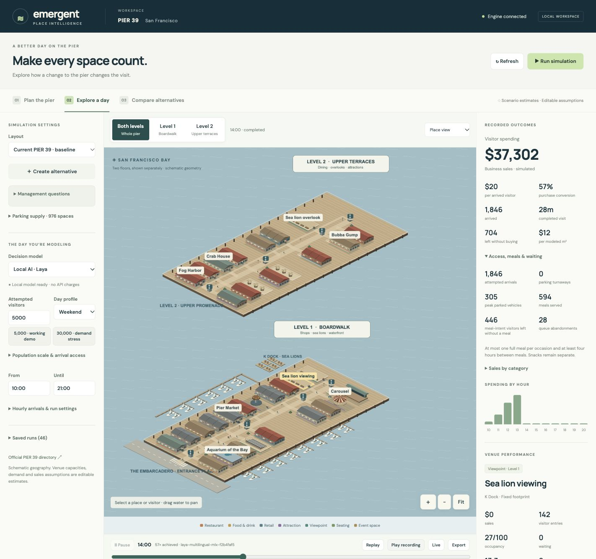

# Emergent · PIER 39

A local planning simulator for PIER 39 management. Change tenant uses, operating hours, amenities, pedestrian paths or parking supply. Compare the current pier with an alternative using the same attempted visitor population, budgets, arrivals and seeds.

The application uses a real Engine-backed simulation. The isometric map shows both levels together or one floor in detail, with storefronts, boardwalks, terraces, the marina, sea lion docks and floor connections. The artwork is illustrative and the geometry is schematic. It is not a surveyed digital twin.



[Five-page project rundown](output/pdf/emergent-project-rundown.pdf).

## Run locally

```sh
git clone https://github.com/LSTu5/emergent.git
cd emergent
npm ci
npm run setup:local
npm run dev
```

Open **http://127.0.0.1:4320**. Subsequent starts only need `npm run dev`.

The local-AI setup targets **Apple Silicon macOS**. Bootstrap requires an existing Node/npm installation (Node 22 or newer recommended). The project installs Node **24.21.0**, SpacetimeDB **2.10.2**, uv, Python 3.12 and pinned Laya MLX dependencies. Initial installation and model download need internet; cached inference is local. No paid hosting or paid API is required.

Ports: Experience **4320**, Engine **4321**, SpacetimeDB **4322**, Laya **4318**. All bind to loopback. The development database is `emergent-pier39`. Keep `.local/db-token.json` with the database; it identifies the authorized writer. Startup reuses healthy project services. Ctrl-C stops services started by that invocation.

## Present the project

1. Open **Current PIER 39**, use **Both levels**, then focus the boardwalk or upper terraces. Click a venue or use the destination directory.
2. Open **Management questions** and create a scenario alternative. For example, replace the upper-level specialty shops with a restaurant. Review the capacity, meal duration, prices and hours in its inspector.
3. Move the promenade kiosk, edit another tenant use or adjust restaurant hours. Undo, redo and reset work across changes. Save a version. Buildings, the pier boundary and structural floor connections stay fixed.
4. Choose **Local AI · Laya**. The default is **5,000 attempted visitors**, 10:00–21:00. A **30,000-visitor demand stress** preset is available. Both are assumptions, not measured daily attendance. Every visitor is modeled in a group; dollars are never scaled up from a smaller sample.
5. Open **Compare alternatives**. Run one illustrative pair or three pairs. The same profiles and arrivals attempt to visit each layout. A parking change can alter how many are admitted.
6. Read absolute sales, percentage changes, seed variation, admitted visitors, parking turnaways, meals, waiting and no-purchase departures. **Where spending moved** separates gains and declines across venues, which reconcile to the net pier-wide change.
7. Open a completed run, press **Replay**, then **Play recording** or scrub the timeline. Switch floors and inspect recorded venue and visitor state. A bundled recording of an actual completed local-AI run is imported on startup for a dependable presentation.

A live local-AI run can take minutes. Achieved speed is displayed; replay is the immediate demo path. The rules provider is faster and explicitly labeled. Geometry is frozen per run, so later edits apply to a new simulation. Saved layouts, reports and runs survive restart. Failed or interrupted pairs remain visible and are excluded from completed-pair summaries.

## Useful management questions

| Scenario | What it tests | Tradeoff |
| --- | --- | --- |
| Retail → upper-level restaurant | Additional meal demand versus restaurant substitution | Removes retail and adds 72 assumed dining places in the same footprint |
| Restaurant → specialty retail | How diners redistribute, and whether browsing produces purchases | Removes dining capacity |
| Bay-end food and seating | Redistribution toward viewpoints through a café and relocated kiosk | Sacrifices retail; competes for finite budgets |
| Parking −300 or +300 spaces | Access sensitivity, admissions and downstream capacity | Hypothetical supply; no construction feasibility or parking-income model |
| Later restaurant hours | Whether visitors can use a later dinner service | Both runs share an extended 10:00–22:00 window; staffing cost is absent |

Scenario templates are questions, not recommended investments. A change may help, hurt or make little difference. No rule requires an intervention to increase sales.

## Visitor and venue model

- **35 destinations on two levels:** named restaurants and attractions, grouped shops, free viewpoints, a stage and two explicitly assumed movable planning objects.
- **Groups:** purpose, interests, budget, time available, meal intent, a preferred landmark where relevant, hunger, fatigue, patience, familiarity, accessibility needs and arrival mode. A person-shaped marker represents a group; metrics count people.
- **Choices:** open, reachable and affordable options with sufficient time left; observed queues, proximity, hunger, fatigue and preferences. The engine offers up to six candidate destinations plus departure. Local AI estimates probabilities, and the engine samples using a seeded stream.
- **Meals:** at most one purchased full restaurant meal per occasion, with at least four hours between meals and a hunger threshold. Cafés are snacks/light refreshments. People do not purchase repeated dinners just because more restaurants exist. Meal-intent departures without a meal are recorded; these are not all proven capacity failures.
- **Aggregate venues:** arrivals consume capacity, wait or abandon, dwell, potentially purchase, then leave. Shops allow browsing without buying. Purchases use integer cents and finite group wallets. Restaurant admission requires enough remaining time for its minimum service duration. No tables, aisles, kitchens or indoor walking are simulated.
- **Parking:** finite spaces and one car per car group. The starting default is 976 published garage spaces, 35% assumed car groups, 300 assumed pre-existing cars and a 30-minute post-visit buffer. Pre-existing cars leave over an assumed 30–180 minutes. Full parking turns a car group away; walk/transit groups still enter. The same attempted cohort is used in both layouts. There is no street traffic, congestion, overflow parking search, fee or parking validation model.
- **Movement:** deterministic graph routing across floors, accessible routes and a coarse crowd-related walking slowdown. Path editing enables/closes predefined segments and changes widths; it is not CAD or a collision-accurate pedestrian model.

## How to interpret results

Business sales are **not management income**. There is no rent, margin, profit, construction cost or ROI model. Prices, capacities, visit durations, purchase probabilities, behavioral parameters, hourly arrival profiles and modeled areas are editable estimates. Reported sales per commercial m² use those estimated areas.

Venue gains and declines reveal redistribution but do not by themselves prove individual substitution or new demand. A three-pair range and standard deviation show seed variation, not a forecast confidence interval. AI probabilities are not calibration. Real management decisions need measured footfall, venue capacities, visit durations and transaction data, then validation on days not used for calibration.

## Sources and scale

Checked **8 November 2026**:

- [Official 2026 map/directory](https://www.pier39.com/wp-content/uploads/2026/02/P39-PIER-Map-for-Website-2026.pdf): destination identities, directory zones, floor assignments, entrance/bay orientation, west-side sea lions, stairs/elevators and two-level organization.
- [Published hours](https://www.pier39.com/pier-info/address-hours/): broad starting category hours; individual exceptions still require confirmation.
- [Operator leasing information](https://www.pier39.com/leasing/): approximately **11 million visitors in 2023**, two levels, 90+ shops/attractions/restaurants, and a **976-space** adjacent garage. Dividing annual visits by 365 gives about **30,000 per day** arithmetically; it is not a measured typical day, seasonal profile, unique-person count or 10:00–21:00 demand curve. The operator also reports a 3.8-hour average stay; the model is not fitted to that figure and its scope/method are not sufficient here for calibration. The leasing page states that no cart/kiosk space is currently available: movable objects represent hypothetical planning changes, not vacant listings.

`shared/baseline.ts` records source URLs and directory zones. Regularized footprints, path widths, connection locations and capacities are not survey data. Marine trips and minor tenants are grouped or outside scope. The garage affects admissions through a bounded module; its building, bridge and street network are not simulated. Official map artwork is linked, not republished as the renderer.

## Architecture and persistence

| Layer | Responsibility |
| --- | --- |
| Experience | React, Vite, PixiJS: isometric two-floor renderer, editor, heatmaps, inspectors, replay and paired reporting |
| Engine | TypeScript/Node: independent cohort generation, 15-second steps, routing, capacity, meals, parking, purchase ledgers and experiments |
| Intelligence | Local Laya MLX probability service; explicit rules mode; optional disabled Jev adapter |
| State | SpacetimeDB stores immutable layout versions, experiment records and run checkpoints/indexes through authenticated reducers; larger state and replay files are compressed and saved atomically in `.data` |
| Shared | `pier39.v2` contract; new runs identify behavior as `pier39.behavior.3` |

Simulation ticks run in Node, not in the database. SpacetimeDB's bounded HTTP reducer body cannot hold large raw populations, so large checkpoints use a small database index referencing an atomic local compressed file. Small records remain in the database. Preserve **both `.local` and `.data`** for the development history; the bundled replay is portable. Legacy smaller JSON recordings remain readable.

Local Laya uses `aac6fef/laya-multilingual-mlx`, revision `f2b4faf51023039425946074e2cf1361d2db11d5`. The model receives recorded state and candidate choices and does not optimize business revenue. Inspector explanations describe actions and context; probabilities are not generated inner thoughts. Provider errors fail visibly and never silently switch to rules.

Jev stays disabled unless `JEV_ENABLED=1` and `JEV_API_KEY` are supplied explicitly. Its external adapter has not been exercised with paid credentials. The normal demo needs no API key.

## Verification

```sh
npm test                 # focused engine, layout, finance, parking and meal tests
npm run build            # TypeScript and production bundle
npm run test:local-ai    # actual checkpoint parity, isolation and HTTP contract
npm run test:e2e         # three 1,000-person local-AI pairs; identical and cancelled controls
npm run test:scale       # one 5,000-person local-AI pair
npm run test:parking     # three 30,000-person rules pairs
npm run demo             # independent Engine/local-AI throughput benchmark
```

Real-service tests require the local stack. They save and reload alternatives, compare exact cohorts, check finite budgets and meals, reconcile hourly/category/venue spending and admissions, inspect both-floor replays, and keep incomplete experiments visible. Scripts write `docs/verification*.json`. `docs/browser-verification.json` records visual and interaction checks. `data/demo-manifest.json` identifies the bundled completed recording and its actual throughput. Timing depends on this Mac, model warmup, pacing and concurrent runs; no performance extrapolation is used.


## Dependencies

Open-source frameworks and the separately downloaded Laya model retain their own licenses. See [third-party dependencies](THIRD_PARTY.md).
